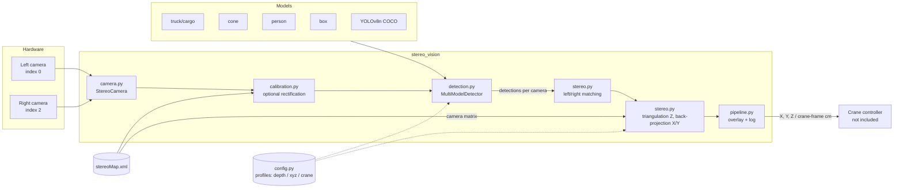

# Autonomous Overhead Crane: Computer Vision & Intelligent Control

Computer-vision and stereo-vision components for an autonomous overhead crane, including object detection, camera calibration, and depth estimation. These components can provide perception inputs to a crane control system; the current repository does not implement the crane controller itself.

The repository contains two related but independently runnable components:

- **Object detection** in [`Detection/`](Detection/): a truck-and-cargo detector (`mytruck`, `fardeaux`) and a separate cone detector (`cone`).
- **Stereo vision** in [`stereo_vision/`](stereo_vision/): camera capture, calibration, and live stereo detection that reports the 3-D position of detected objects.

<!--
Demo: record a short screen capture of `python -m stereo_vision detect --mode crane`,
save it as docs/demo.gif, and replace this comment with:

-->

## Architecture



For every frame pair, each model runs on both images. Overlapping boxes are merged, keeping the highest-confidence class unless the pair is allowed to coexist (for example cargo on a truck). Each right-camera detection is paired with the most similar left-camera detection: same class, similar row, small horizontal offset. Depth is computed as `Z = baseline × fx / disparity`, and X/Y come from back-projecting the box centre through the camera matrix.

## Repository layout

```text
.
├── Detection/
│   ├── models/
│   │   ├── cone/best.pt
│   │   └── truck-cargo/best.pt
│   └── training_and_evaluation.ipynb
├── stereo_vision/
│   ├── __main__.py                    # `python -m stereo_vision ...`
│   ├── cli.py                         # command-line interface
│   ├── config.py                      # hardware settings, thresholds, detection profiles
│   ├── camera.py                      # StereoCamera (open / read / release)
│   ├── detection.py                   # MultiModelDetector, overlap suppression
│   ├── stereo.py                      # matching, triangulation, intrinsics
│   ├── pipeline.py                    # live detection loop
│   ├── visualization.py               # drawing helpers
│   ├── calibration.py                 # load stereoMap.xml, rectification
│   ├── calibrate_stereo.py            # compute stereoMap.xml
│   ├── capture_calibration_images.py  # capture chessboard pairs
│   ├── preview_stereo_cameras.py      # side-by-side camera preview
│   ├── image_io.py                    # image I/O that supports non-ASCII paths
│   ├── model_paths.py                 # checkpoint path resolution
│   └── stereoMap.xml                  # calibration for the original camera pair
├── .gitignore
└── requirements.txt
```

Datasets, captured camera images, downloaded weights, and generated training runs are intentionally excluded from Git. The included detector checkpoints and stereo calibration file are retained.

## Hardware

| Component | Value used by the code | Where to change it |
|---|---|---|
| Cameras | Two USB (UVC) cameras mounted side by side | — |
| Camera indexes | Left `0`, right `2` | `--left` / `--right`, or `CameraConfig` in `config.py` |
| Resolution | 640 × 480 | `CameraConfig` |
| Baseline (distance between lenses) | 7 cm | `StereoConfig.baseline_cm` |
| Horizontal field of view | 84° (used when calibrated intrinsics are unavailable) | `StereoConfig.horizontal_fov_deg` |
| Lens focal length | 3.6 mm (nominal, informational) | — |
| Depth range reported | 10–500 cm | `StereoConfig.min_depth_cm` / `max_depth_cm` |
| Calibration target | Chessboard with 7 × 7 inner corners (8 × 8 squares) | `CHESSBOARD_SIZE` in `calibrate_stereo.py` |
| Camera position in crane frame | X = 47.5 cm, Y = 17.5 cm (camera X/Y axes swapped) | `CraneFrame` in `config.py` |
| Compute | CPU works; an NVIDIA GPU with CUDA PyTorch is much faster | — |

## Setup

Use Python 3.10 or later. From the repository root, create and activate a virtual environment, then install dependencies:

```powershell
py -m venv .venv
.\.venv\Scripts\Activate.ps1
python -m pip install -r requirements.txt
```

## Object detection

The truck-and-cargo detector recognizes `mytruck` and `fardeaux`; the separate cone detector recognizes `cone`. The checkpoints are in `Detection/models/`. The cone checkpoint is available for predictions, but its original training dataset and configuration were not supplied, so its training cannot be reproduced.

### Dataset and training

The truck-and-cargo model uses Roboflow's **My First Project, version 4**, exported in Pascal VOC format. Its classes are `fardeaux` and `mytruck`, and the supplied dataset contains 3,038 images across train, validation, and test splits. The dataset is not included in this repository. Obtain it from [Roboflow Universe](https://universe.roboflow.com/hibara/my-first-project-kjp9a) and export as Pascal VOC. The notebook expects the `train`, `valid`, and `test` directories under `Detection/data/truck-cargo-v4/`. The notebook also supports the original workspace layout with a sibling `Dataset/` folder.

The dataset is licensed under [CC BY 4.0](https://creativecommons.org/licenses/by/4.0/). Review its attribution requirements before redistributing the dataset or derived material.

Open `Detection/training_and_evaluation.ipynb` in Jupyter or VS Code and run its cells from top to bottom. Training is opt-in: set `TRAIN_TRUCK_CARGO = True` to train for 50 epochs at image size 416 and batch size 8. Otherwise, the notebook evaluates the included checkpoint on the held-out test split and reports precision, recall, mAP@50, and mAP@50-95. Avoid using the test split to tune the model. The notebook converts XML annotations to YOLO labels in a temporary directory and leaves the source dataset unchanged.

The included truck-and-cargo checkpoint was evaluated on 110 version 4 test images containing 157 annotated instances:

| Metric | Result |
|---|---:|
| Precision | 0.9987 |
| Recall | 1.0000 |
| mAP@50 | 0.9950 |
| mAP@50-95 | 0.9053 |

Per-class mAP@50-95 was 0.8716 for `fardeaux` and 0.9390 for `mytruck`. These metrics describe this held-out split and do not guarantee performance in other environments or camera setups. Some test images come from the same capture sessions as training images, so these scores are likely optimistic.

## Stereo vision

All stereo tools are available through one command-line interface. Run it from the repository root:

```powershell
python -m stereo_vision --help
```

### 1. Check the cameras

```powershell
python -m stereo_vision preview            # press q to quit
```

The left image must appear on the left. If not, swap the indexes with `--left` and `--right`.

### 2. Calibrate

```powershell
python -m stereo_vision capture            # press s to save a pair, Esc to quit
python -m stereo_vision calibrate          # writes stereo_vision/stereoMap.xml
```

Capture 20–40 pairs with the chessboard fully visible in both cameras, at different distances, positions and tilts. The calibration logs how many pairs were usable and the stereo reprojection error; aim for well under 1 px. The included `stereoMap.xml` is specific to the original camera pair; recalibrate for different cameras, mounting, or resolution.

### 3. Run live detection

Three detection modes are available:

| Mode | Output | Notes |
|---|---|---|
| `depth` | Z | Focal length estimated from the field of view; all model classes are shown. |
| `xyz` (default) | X, Y, Z in the right-camera frame | Uses the calibrated camera matrix; only truck, cargo and cone classes are kept. |
| `crane` | X, Y, Z and crane-frame X/Y | As `xyz`, plus aspect-ratio filters that reject implausible truck and cone boxes. |

The detector uses the included truck/cargo and cone checkpoints. It also requires custom person and box checkpoints, which are not included. Set their paths before running:

```powershell
$env:PERSON_MODEL_PATH = "C:\path\to\person.pt"
$env:BOX_MODEL_PATH = "C:\path\to\box.pt"
python -m stereo_vision detect --mode crane
```

Optional `TRUCK_CARGO_MODEL_PATH`, `CONE_MODEL_PATH` and `COCO_MODEL_PATH` variables override the other checkpoints. Relative paths are resolved from the repository root. If `stereo_vision/yolov8n.pt` is absent, Ultralytics downloads the official COCO model on first use.

Other useful options:

```powershell
python -m stereo_vision detect --left 1 --right 0   # different camera indexes
python -m stereo_vision detect --rectify            # rectify frames with stereoMap.xml first
python -m stereo_vision -v detect                   # debug logging
```

Measurements are drawn on both camera windows and logged to the console. Press `q` to quit.

### Configuration

Hardware values, confidence thresholds, class aliases, matching tolerances and the crane-frame offset are all defined in [`stereo_vision/config.py`](stereo_vision/config.py). To tune a mode, edit its entry in `PROFILES`. To add a mode, add a new `Profile`; it appears in `--mode` automatically.

### Known limitations

- Frames are not rectified by default, so the left/right matching tolerances are deliberately generous (60 px vertical).
- Depth includes an empirical correction factor (`StereoConfig.distance_scale`, from a 90 cm reference measured as 50 cm). Recalibrating with the real chessboard square size would make this unnecessary.
- In the `xyz` and `crane` modes, person and box detections are filtered out by the allowed-class list, even though both models run.
- Each frame runs five models on both cameras. Expect a low frame rate on CPU.

## Troubleshooting

| Symptom | Likely cause and fix |
|---|---|
| `Cannot open camera N` | Wrong index, or the camera is used by another app. Run `preview` with other `--left` / `--right` values (indexes often skip numbers on laptops with a built-in webcam). |
| Left and right windows are swapped | Swap the `--left` and `--right` values. |
| `Model file not found ... Set PERSON_MODEL_PATH` | The person and box checkpoints are not in the repository. Set the environment variables shown above. |
| `TRACKING LOST` shown constantly | Nothing was detected in at least one camera. Check lighting and that the object is visible in both views. |
| Detections appear but no distance is shown | No left/right match was found within the tolerances, or the depth fell outside 10–500 cm. Make sure both cameras are level and parallel, or recalibrate and try `--rectify`. |
| Distances are consistently off by a factor | Check `baseline_cm` against the real distance between lenses, then recalibrate. |
| `Calibration file not readable` or intrinsics warning | `stereoMap.xml` is missing or incomplete; the code falls back to the field-of-view approximation. Run `capture` and `calibrate`. |
| `No 7x7 chessboard corners were found` | The board was not fully visible in both images, or it has a different number of inner corners. Recapture, or change `CHESSBOARD_SIZE`. |
| Very slow / low FPS | Inference runs on CPU. Install a CUDA build of PyTorch, or remove unneeded models from the profile in `config.py`. |
| Paths with accents (e.g. `détection`) | Supported: image and calibration files are read and written through Python rather than OpenCV's file functions. |

## License and publication notes

No license has been selected for the project code. Add a code license before publishing if you want to grant reuse permissions. Check the rights and attribution requirements for each included model and any camera images before distributing them.
